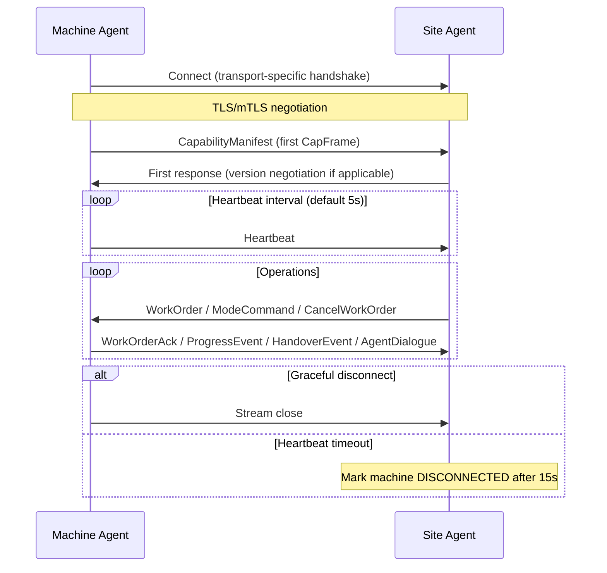

<!--
SPDX-License-Identifier: Apache-2.0
Copyright 2026 CAP Authors
-->

# Chapter 4: Communication Model

> **Normative.** This chapter defines the transport-level requirements for CAP communication.
> CAP is transport-neutral (see ADR-002): the protocol semantics are defined by protobuf
> message types, and multiple transport bindings are supported.

---

## 4.1 Transport Architecture

CAP defines a **semantic layer** (CapFrame messages) and a **transport layer** (how those
messages are delivered). The semantic layer is normative; the transport layer is defined
by **transport profiles** that map CapFrame semantics to specific protocols.

```
┌─────────────────────────────────────────────┐
│  CAP Semantic Layer (CapFrame messages)      │
│  Defined by: cap/v0/*.proto                  │
├─────────────────────────────────────────────┤
│  Transport Profiles                          │
│  ┌──────────┐  ┌──────────┐  ┌───────────┐ │
│  │  gRPC    │  │  MQTT    │  │ WebSocket │ │
│  │ (primary)│  │ (IoT)   │  │ (browser) │ │
│  └──────────┘  └──────────┘  └───────────┘ │
├─────────────────────────────────────────────┤
│  TLS 1.3 (mandatory in production)          │
└─────────────────────────────────────────────┘
```

### 4.1.1 Transport Profile Requirements

Every transport profile MUST:

1. Deliver `CapFrame` messages reliably between peers.
2. Preserve message boundaries (one `CapFrame` per transport message).
3. Support bidirectional communication (both Site Agent and Machine Agent send and receive).
4. Provide `MessageHeader` passthrough without modification.
5. Support TLS 1.3 for production deployments.

Every transport profile SHOULD:

1. Preserve message ordering within a single logical connection.
2. Provide connection lifecycle events (connected, disconnected, error).
3. Support keepalive / heartbeat at the transport level.

---

## 4.2 Connection Lifecycle

Regardless of transport, a CAP connection follows this lifecycle:



### 4.2.1 Connection Establishment Rules

1. The **first message** from Machine Agent to Site Agent MUST be a `CapabilityManifest`.
   Any other message before `CapabilityManifest` MUST be rejected with `CapError(2006, UNEXPECTED_MESSAGE)`.

2. The Site Agent MUST register the machine upon receiving a valid `CapabilityManifest`.

3. `ConnectRequest.supported_versions` (gRPC only) enables version negotiation.
   If no common version exists, the Site Agent responds with `CapError(2003, VERSION_MISMATCH)`
   and closes the stream.

### 4.2.2 Heartbeat Requirements

| Parameter | Default | Configurable? | Description |
|-----------|---------|---------------|-------------|
| `heartbeat_interval` | 5 seconds | Yes (Machine Agent) | Interval between Heartbeat messages |
| `heartbeat_timeout` | 15 seconds | Yes (Site Agent) | Time after last Heartbeat before marking machine as disconnected |

- Machine Agent MUST send Heartbeat at regular intervals.
- Site Agent MUST track `last_heartbeat` per machine.
- If `heartbeat_timeout` expires: Site Agent marks machine as `DISCONNECTED` and initiates
  the reconnection protocol (see Chapter 8, Section 8.3.2).

### 4.2.3 Keepalive

Transport-level keepalive is distinct from CAP Heartbeat:

| Mechanism | Layer | Purpose | Default |
|-----------|-------|---------|---------|
| Heartbeat | CAP (application) | Machine health + aliveness | 5s interval |
| gRPC keepalive | Transport | TCP connection liveness | 30s (implementation-defined) |
| MQTT keepalive | Transport | MQTT session liveness | 60s |
| WebSocket ping/pong | Transport | WebSocket frame liveness | 30s |

Both layers are necessary: transport keepalive detects dead TCP connections; CAP Heartbeat
detects application-level failures (e.g., crashed process with open socket).

---

## 4.3 gRPC Transport Profile

> **Primary transport.** The reference implementation uses gRPC.

### 4.3.1 Service Definition

```protobuf
service CapRuntimeService {
  rpc Connect(stream ConnectRequest) returns (stream ConnectResponse);
}
```

- Single bidirectional streaming RPC.
- Both client (Machine Agent) and server (Site Agent) send and receive `CapFrame` wrapped
  in `ConnectRequest` / `ConnectResponse`.

### 4.3.2 Serialization

- Wire format: Protocol Buffers binary encoding.
- Content-Type: `application/grpc+proto`

### 4.3.3 Connection Parameters

| Parameter | Recommended Value | Description |
|-----------|------------------|-------------|
| Max message size | 4 MB | Protects against oversized messages |
| Keepalive interval | 30 seconds | gRPC HTTP/2 PING frames |
| Keepalive timeout | 10 seconds | Time to wait for PING ACK |
| Max concurrent streams | 1 per machine | Each machine opens one stream |
| Compression | gzip (optional) | May reduce bandwidth on constrained links |

### 4.3.4 Reconnection

On stream failure:
1. Client detects via gRPC status code (UNAVAILABLE, CANCELLED, etc.).
2. Exponential backoff: initial=1s, max=60s, factor=2×, jitter=±25%.
3. On reconnect: send fresh `CapabilityManifest` as first message.

### 4.3.5 Version Negotiation

```
ConnectRequest {
  frame: CapFrame { CapabilityManifest { ... } }
  supported_versions: ["v0.1"]
}

ConnectResponse {
  frame: CapFrame { ... }
  negotiated_version: "v0.1"
}
```

If `supported_versions` is empty, the site agent assumes the client supports the latest
v0.x version.

---

## 4.4 MQTT Transport Profile

> **IoT transport.** Suitable for bandwidth-constrained or intermittent connections
> common on construction sites.

### 4.4.1 Topic Structure

```
cap/v0/{site_id}/machines/{machine_id}/up      # Machine → Site (upstream)
cap/v0/{site_id}/machines/{machine_id}/down    # Site → Machine (downstream)
cap/v0/{site_id}/events                         # Broadcast events (SafetyEvent, AuditEvent)
cap/v0/{site_id}/control                        # Site-wide commands (emergency stop broadcast)
```

- `{site_id}`: Unique identifier for the construction site.
- `{machine_id}`: Must match `CapabilityManifest.machine_id`.
- Machine Agents subscribe to their `down` topic and publish to their `up` topic.
- Site Agent subscribes to `cap/v0/{site_id}/machines/+/up` (wildcard).

### 4.4.2 Message Format

- **Payload**: Protobuf-serialized `CapFrame` (binary).
- **Content-Type property** (MQTT v5): `application/x-protobuf`
- **JSON mode** (optional, for debugging): JSON-serialized CapFrame with Content-Type
  `application/json`. Implementations MUST support binary; JSON support is OPTIONAL.

### 4.4.3 QoS Mapping

| CAP Message Type | MQTT QoS | Rationale |
|-----------------|----------|-----------|
| Heartbeat | QoS 0 (at most once) | Periodic, loss of one heartbeat is tolerable |
| ProgressEvent | QoS 0 | Periodic progress updates, next update corrects any loss |
| WorkOrder | QoS 1 (at least once) | Critical task assignment, must be delivered |
| WorkOrderAck | QoS 1 | Critical response, must be delivered |
| CancelWorkOrder | QoS 1 | Must reliably reach the machine |
| ModeCommand | QoS 1 | Safety-relevant mode change |
| HandoverEvent | QoS 1 | Safety-relevant handover request |
| SafetyEvent | QoS 1 | Safety-critical, must be delivered |
| FaultEvent | QoS 1 | Fault must be reported reliably |
| ReservationRequest | QoS 1 | Must be reliably processed |
| ReservationStatus | QoS 1 | Must reach requester |
| CapError | QoS 1 | Error must be reliably delivered |
| AgentDialogue | QoS 1 | Dialogue integrity required |
| ALOStateUpdate | QoS 0 | Periodic state sync, next update corrects any loss |
| CapabilityManifest | QoS 1 | Registration must succeed |

### 4.4.4 Last Will and Testament (LWT)

Machine Agents MUST configure an MQTT Last Will message:

- **Topic**: `cap/v0/{site_id}/machines/{machine_id}/up`
- **Payload**: `CapFrame` containing a `FaultEvent` with:
  - `fault_code = "UNEXPECTED_DISCONNECT"`
  - `severity = ERROR`
  - `summary = "Machine agent disconnected unexpectedly"`
- **QoS**: 1
- **Retain**: false

This ensures the Site Agent is notified of unexpected disconnections even when the
Machine Agent process crashes without sending a goodbye message.

### 4.4.5 Connection Lifecycle (MQTT-specific)

1. Machine Agent connects to MQTT broker with LWT configured.
2. Machine Agent subscribes to `cap/v0/{site_id}/machines/{machine_id}/down`.
3. Machine Agent publishes `CapabilityManifest` to its `up` topic (first message).
4. Site Agent processes manifest and begins sending on the `down` topic.
5. Heartbeat loop: Machine Agent publishes Heartbeat to `up` topic every `heartbeat_interval`.
6. On disconnect: LWT fires, notifying the Site Agent.

### 4.4.6 Access Control List (ACL)

MQTT broker MUST enforce per-topic ACL:

| Client Identity | Publish | Subscribe |
|----------------|---------|-----------|
| machine_id=`M1` | `cap/v0/+/machines/M1/up` | `cap/v0/+/machines/M1/down`, `cap/v0/+/events`, `cap/v0/+/control` |
| site_agent | `cap/v0/+/machines/+/down`, `cap/v0/+/events`, `cap/v0/+/control` | `cap/v0/+/machines/+/up` |
| observer | (none) | `cap/v0/+/events` |

### 4.4.7 Idempotency

MQTT QoS 1 guarantees **at least once** delivery, meaning duplicates are possible.
Receivers MUST use `MessageHeader.message_id` for deduplication. A message with a
previously seen `message_id` SHOULD be silently discarded (with optional
`CapError(2005, DUPLICATE_MESSAGE_ID)` response).

---

## 4.5 WebSocket Transport Profile

> **Browser transport.** For the operator console and monitoring dashboards.

### 4.5.1 Endpoint

```
wss://{host}:{port}/cap/v0/ws
```

- Subprotocol: `cap.v0` (specified in the `Sec-WebSocket-Protocol` header).

### 4.5.2 Message Format

- **Text frames**: JSON-serialized `CapFrame` (for browser compatibility).
- **Binary frames**: Protobuf-serialized `CapFrame` (for efficiency).
- Implementations MUST support text (JSON) frames. Binary frames are OPTIONAL.

### 4.5.3 Authentication

- JWT token is passed as a query parameter or in the first text frame:
  - Query parameter: `wss://host/cap/v0/ws?token={jwt}`
  - First frame: `{"auth": {"token": "{jwt}"}}`
- The server MUST validate the JWT before sending any CapFrames.
- On token expiration: server sends `CapError(3006)` and closes the connection.

### 4.5.4 Scope Limitations

The WebSocket profile is designed for **read-heavy, low-frequency** use cases:

- Dashboard state visualization
- Event stream monitoring
- Audit log retrieval
- Manual WorkOrder submission by operators

It is NOT recommended for:
- Machine Agent primary communication (use gRPC or MQTT)
- High-frequency Heartbeat streaming (use gRPC or MQTT)

---

## 4.6 Transport Selection Guidelines

| Use Case | Recommended Transport | Rationale |
|----------|----------------------|-----------|
| Machine Agent on rugged PC | gRPC | Reliable bidirectional streaming, strong typing |
| Machine Agent on constrained IoT device | MQTT | Low overhead, works over spotty connections |
| Operator console (browser) | WebSocket | Browser-native, human interaction patterns |
| Monitoring / audit dashboard | WebSocket | Read-heavy, event-driven |
| Cross-site federation | gRPC | Strong authentication, efficient binary protocol |

---

## 4.7 Message Size Limits

| Limit | Value | Rationale |
|-------|-------|-----------|
| Maximum CapFrame size | 4 MB | Covers large ALO descriptors with embedded properties |
| Maximum Heartbeat size | 64 KB | Heartbeats should be lightweight |
| Maximum AgentDialogue size | 1 MB | Dialogue may contain detailed reasoning |
| Recommended CapFrame size | < 64 KB | For bandwidth-constrained environments |

Implementations SHOULD reject messages exceeding these limits with `CapError(2004, INVALID_MESSAGE)`.
