<!--
SPDX-License-Identifier: Apache-2.0
Copyright 2026 CAP Authors
-->

# Chapter 5: Protocol Flows

> **Normative.** This chapter defines the required message sequences for all CAP
> protocol flows. Implementations MUST follow these sequences.

---

## 5.1 Connection Flow

Every CAP session begins with a connection handshake.

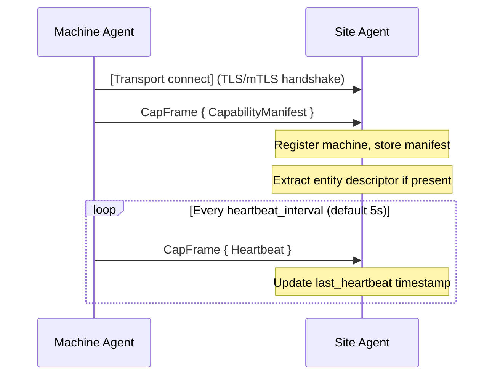

**Rules:**
1. The first CapFrame from Machine Agent MUST be a CapabilityManifest.
2. Any other message before CapabilityManifest → `CapError(2006)`.
3. Heartbeat MUST begin within one `heartbeat_interval` after connection.

---

## 5.2 WorkOrder Lifecycle

The standard task assignment and execution flow.

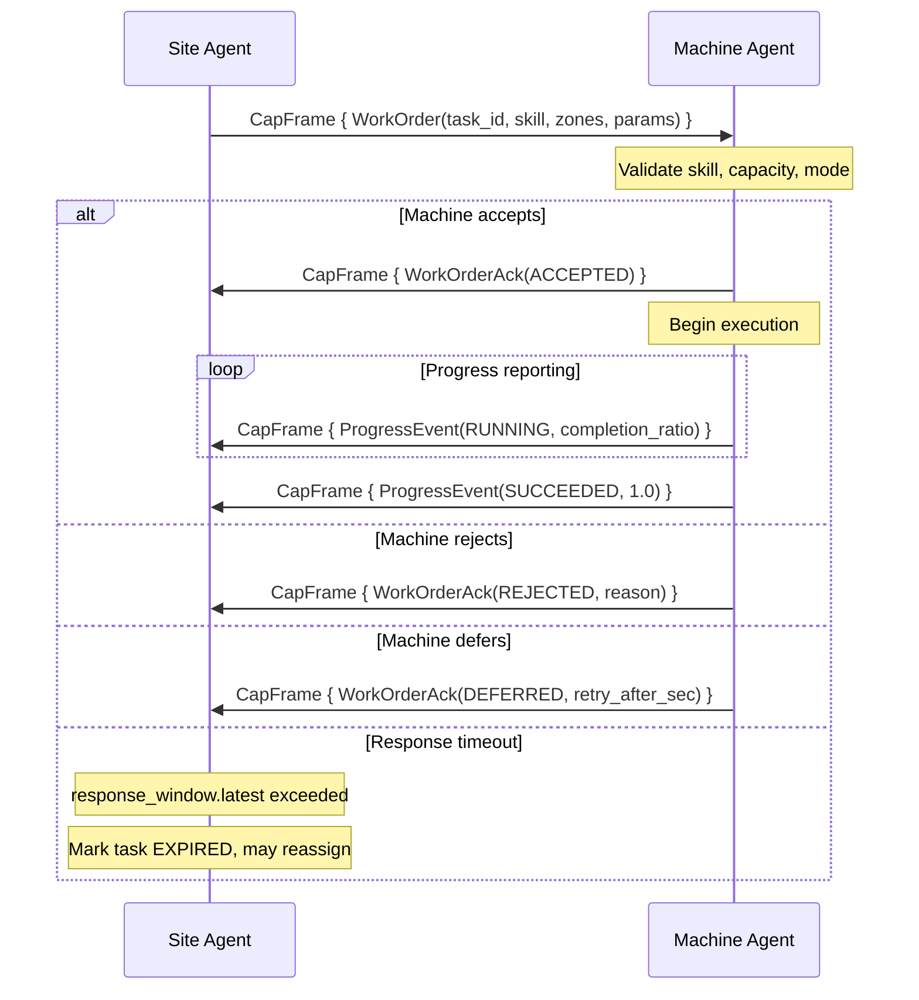

---

## 5.3 Cancellation Flow

The Site Agent can cancel a task at any non-terminal state.

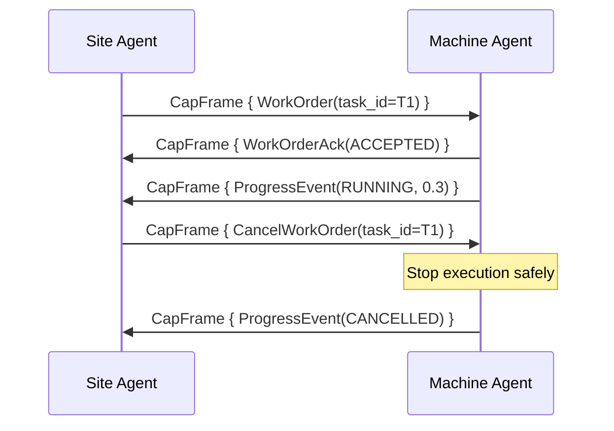

**Rules:**
1. Machine MUST stop execution safely (not abruptly) upon receiving CancelWorkOrder.
2. Machine MUST send a final ProgressEvent with state=CANCELLED.
3. CancelWorkOrder for a task in terminal state → `CapError(2001)`.

---

## 5.4 Handover Flow

Transition from autonomous to human-operated control.

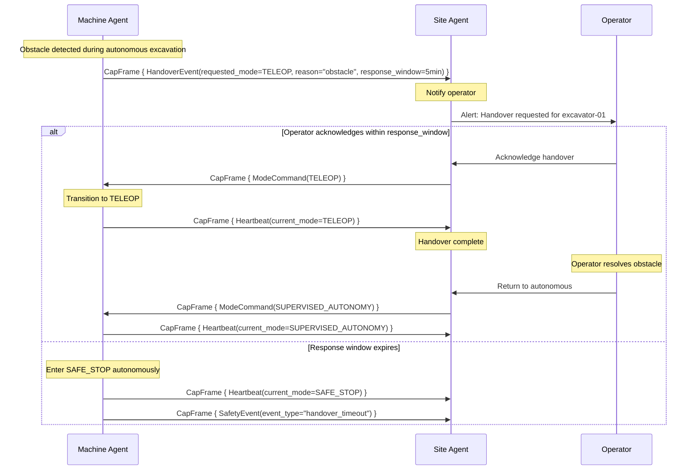

---

## 5.5 Reservation Flow

Resource reservation for multi-machine coordination.

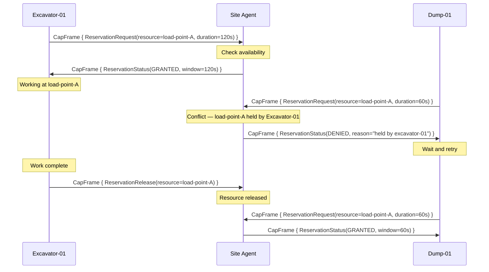

---

## 5.6 Agent Dialogue Flow

Structured communication between Machine Agent and Site Agent.

### 5.6.1 Situation Report

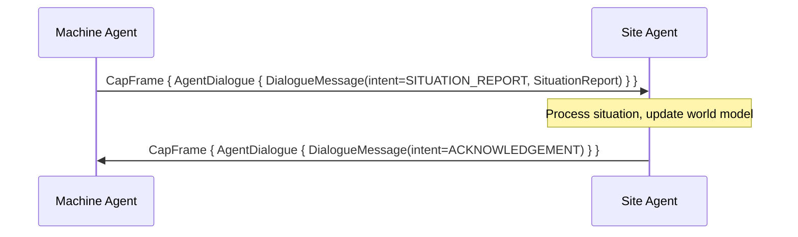

### 5.6.2 Local Decision with Approval

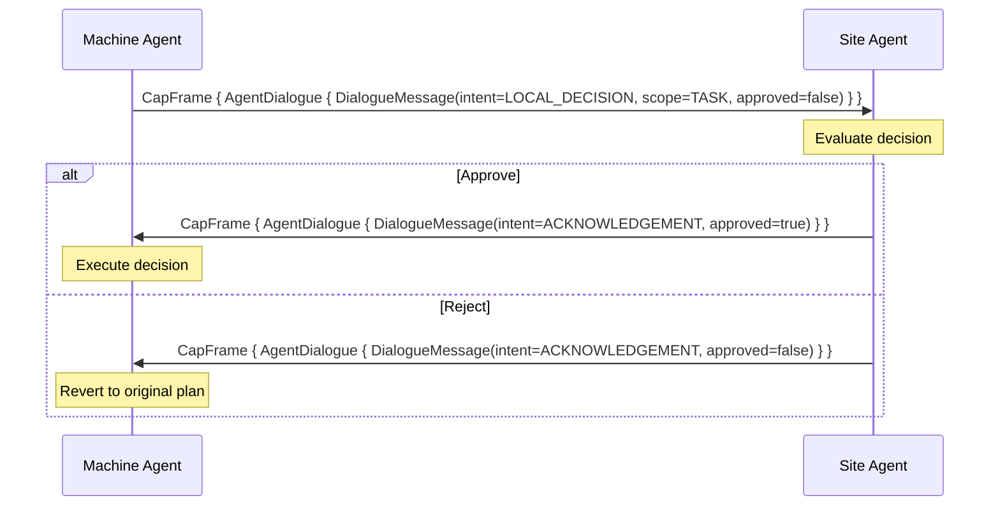

### 5.6.3 Plan Proposal

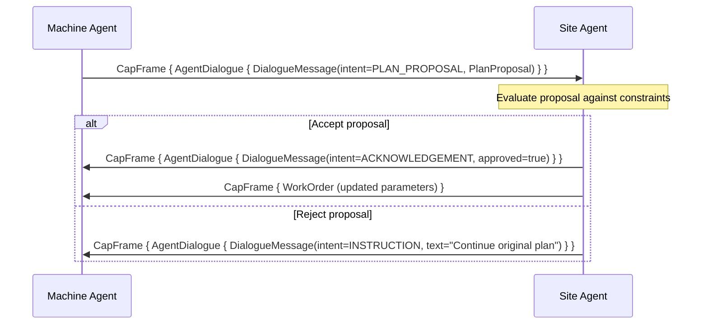

---

## 5.7 Entity-Descriptor Synchronization Flow

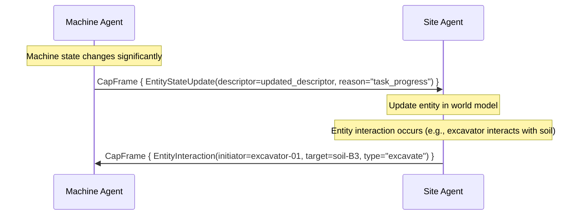

---

## 5.8 Reconnection Flow

Recovery after a network partition or machine restart.

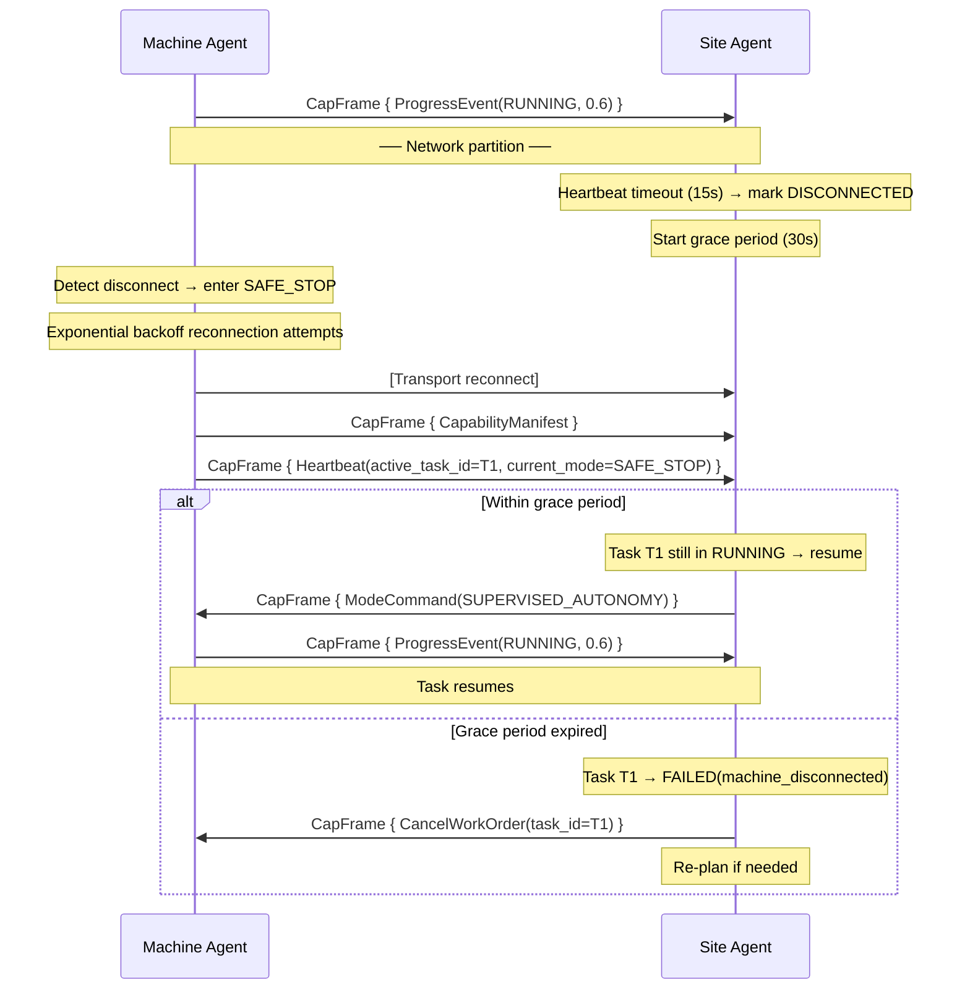

---

## 5.9 Excavate-and-Haul Cycle (End-to-End)

Complete cycle involving two machines cooperating.

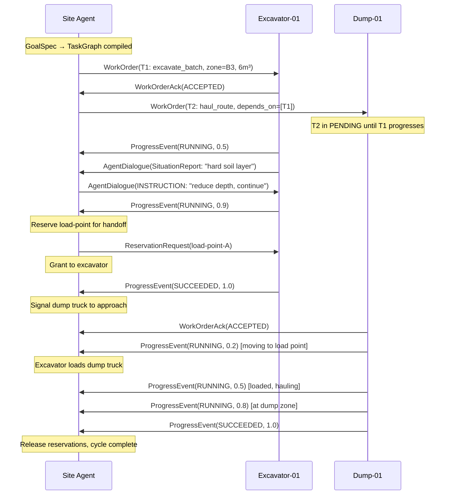

---

## 5.10 Error Flow

See Chapter 8 for detailed error handling. Summary flow:

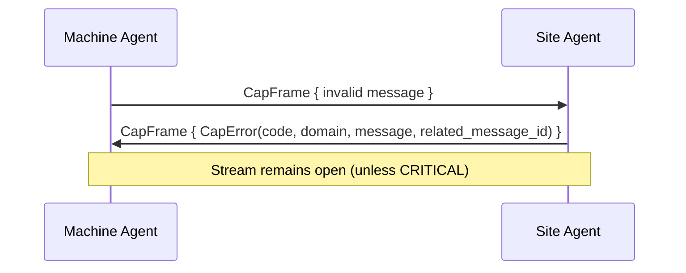
