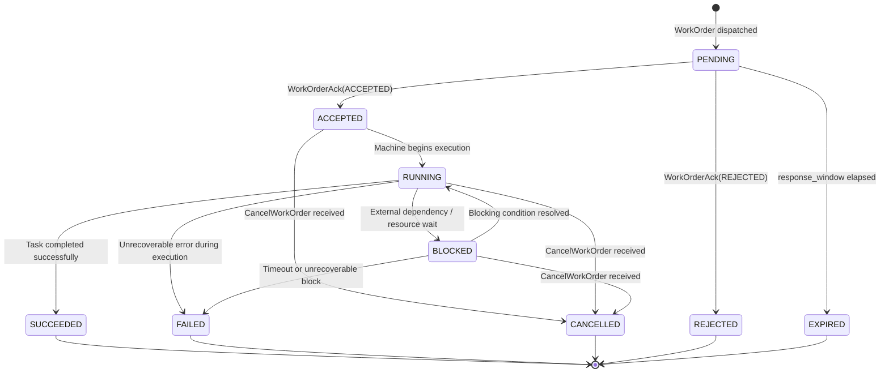
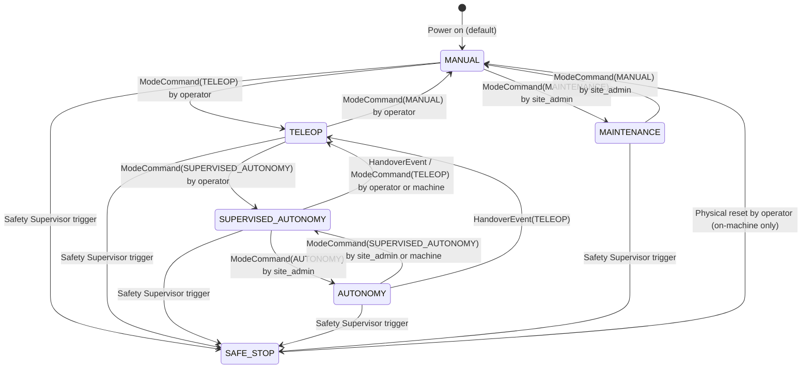
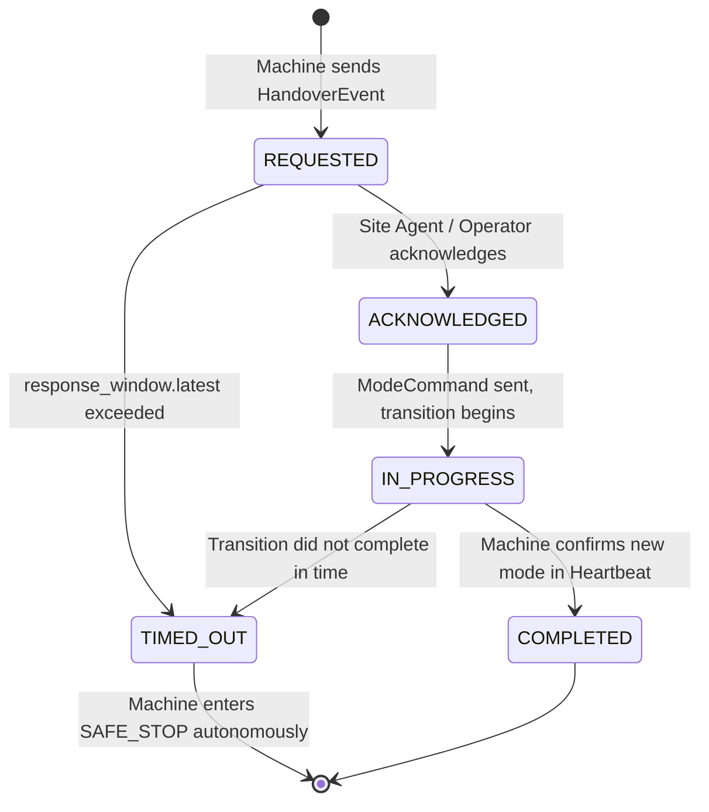
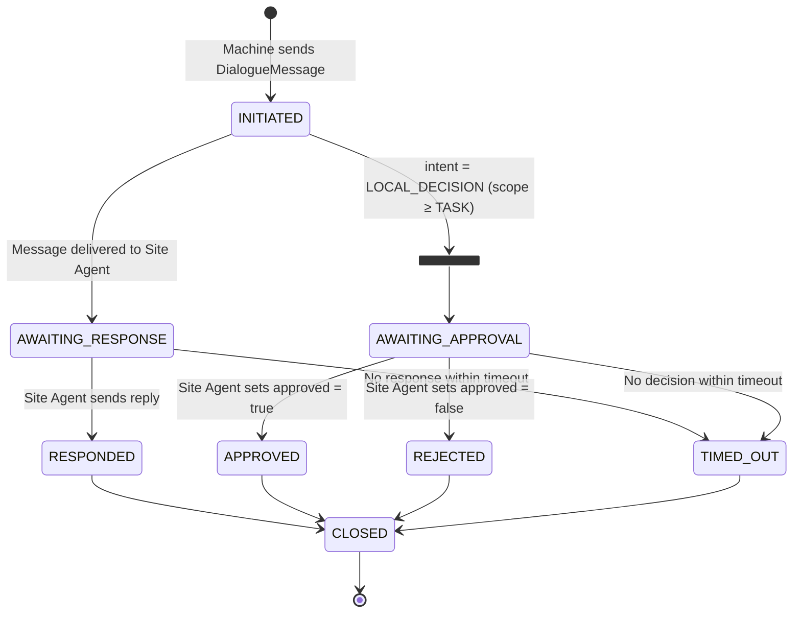

<!--
SPDX-License-Identifier: Apache-2.0
Copyright 2026 CAP Authors
-->

# Chapter 6: State Machines

> **Normative.** All CAP-conformant implementations MUST enforce the state transitions
> defined in this chapter. Invalid transitions MUST be rejected with a `CapError`
> (error_code 2001, `INVALID_STATE_TRANSITION`).

---

## 6.1 TaskState

`TaskState` governs the lifecycle of a single `WorkOrder` from assignment to terminal
completion. It is reported in `ProgressEvent.state` and tracked by both the Machine Agent
and Site Agent.

### 6.1.1 State Diagram

### 6.1.2 State Descriptions

| State | Description |
|-------|-------------|
| `PENDING` | WorkOrder has been dispatched by the Site Agent but not yet acknowledged by the Machine Agent. |
| `ACCEPTED` | Machine Agent has acknowledged the WorkOrder and is preparing to execute. |
| `RUNNING` | Machine Agent is actively executing the task. ProgressEvents with `completion_ratio` are expected. |
| `BLOCKED` | Execution is temporarily suspended due to external conditions (e.g., reservation denied, waiting for another machine, environmental hazard). |
| `SUCCEEDED` | Task completed successfully. `completion_ratio` MUST be 1.0. Terminal state. |
| `FAILED` | Task terminated due to an unrecoverable error. `ProgressEvent.summary` SHOULD describe the failure reason. Terminal state. |
| `CANCELLED` | Task was cancelled by the Site Agent via `CancelWorkOrder`. Terminal state. |
| `REJECTED` | Machine Agent declined the WorkOrder (e.g., skill not supported, capacity exceeded). Terminal state. |
| `EXPIRED` | Machine Agent did not respond within the `response_window` defined in the WorkOrder. Terminal state. |

### 6.1.3 Transition Rules

| From | Event / Trigger | To | Condition | Notes |
|------|----------------|----|-----------|-------|
| `PENDING` | `WorkOrderAck(ACCEPTED)` | `ACCEPTED` | Machine has the required skill and capacity | |
| `PENDING` | `WorkOrderAck(REJECTED)` | `REJECTED` | Machine cannot execute the task | `reason` field MUST be set |
| `PENDING` | `WorkOrderAck(DEFERRED)` | `PENDING` | Machine temporarily cannot accept | `retry_after_sec` SHOULD be set |
| `PENDING` | Response window elapsed | `EXPIRED` | `TimeWindow.latest` exceeded without Ack | Site Agent MAY reassign |
| `ACCEPTED` | First `ProgressEvent(RUNNING)` | `RUNNING` | Machine begins physical execution | |
| `ACCEPTED` | `CancelWorkOrder` | `CANCELLED` | Site Agent cancels before execution starts | |
| `RUNNING` | `ProgressEvent(BLOCKED)` | `BLOCKED` | External blocking condition detected | `summary` SHOULD describe the blocker |
| `RUNNING` | `ProgressEvent(SUCCEEDED)` | `SUCCEEDED` | Task completed | `completion_ratio` MUST equal 1.0 |
| `RUNNING` | `ProgressEvent(FAILED)` | `FAILED` | Unrecoverable error | `summary` MUST describe the error |
| `RUNNING` | `CancelWorkOrder` | `CANCELLED` | Site Agent requests cancellation | Machine MUST stop safely |
| `BLOCKED` | `ProgressEvent(RUNNING)` | `RUNNING` | Blocking condition resolved | |
| `BLOCKED` | `ProgressEvent(FAILED)` | `FAILED` | Block cannot be resolved | |
| `BLOCKED` | `CancelWorkOrder` | `CANCELLED` | Site Agent cancels during block | |

### 6.1.4 State × Event Matrix

> Cells: **next state** if valid, **ERROR** if the transition is invalid and MUST generate
> `CapError(2001)`, **IGNORE** if the event is silently discarded.

| Current State \ Event | WorkOrderAck (ACCEPTED) | WorkOrderAck (REJECTED) | WorkOrderAck (DEFERRED) | ProgressEvent (RUNNING) | ProgressEvent (BLOCKED) | ProgressEvent (SUCCEEDED) | ProgressEvent (FAILED) | CancelWorkOrder | Response Timeout |
|---|---|---|---|---|---|---|---|---|---|
| **PENDING** | ACCEPTED | REJECTED | PENDING | ERROR | ERROR | ERROR | ERROR | CANCELLED | EXPIRED |
| **ACCEPTED** | ERROR | ERROR | ERROR | RUNNING | ERROR | ERROR | ERROR | CANCELLED | — |
| **RUNNING** | ERROR | ERROR | ERROR | IGNORE¹ | BLOCKED | SUCCEEDED | FAILED | CANCELLED | — |
| **BLOCKED** | ERROR | ERROR | ERROR | RUNNING | IGNORE¹ | ERROR | FAILED | CANCELLED | — |
| **SUCCEEDED** | ERROR | ERROR | ERROR | ERROR | ERROR | ERROR | ERROR | ERROR | — |
| **FAILED** | ERROR | ERROR | ERROR | ERROR | ERROR | ERROR | ERROR | ERROR | — |
| **CANCELLED** | ERROR | ERROR | ERROR | ERROR | ERROR | ERROR | ERROR | ERROR | — |
| **REJECTED** | ERROR | ERROR | ERROR | ERROR | ERROR | ERROR | ERROR | ERROR | — |
| **EXPIRED** | ERROR | ERROR | ERROR | ERROR | ERROR | ERROR | ERROR | ERROR | — |

> ¹ IGNORE: A `ProgressEvent` reporting the same state as the current state is treated as
> a progress update (e.g., updated `completion_ratio`) and does not trigger a state transition.

---

## 6.2 MachineMode

`MachineMode` defines the operating autonomy level of a machine. It is reported in
`Heartbeat.current_mode` and can be changed via `ModeCommand` or `HandoverEvent`.

### 6.2.1 State Diagram

### 6.2.2 State Descriptions

| Mode | Description | LLM Involvement |
|------|-------------|-----------------|
| `MANUAL` | Fully manual control. Operator controls all actuators directly. | None |
| `TELEOP` | Remote operation. Operator controls the machine via the operator console. | None |
| `SUPERVISED_AUTONOMY` | Autonomous execution with operator oversight. Machine executes CAP WorkOrders autonomously but an operator monitors and can intervene. | Layer [B]: Machine Agent LLM/SLM provides advisory situation reports |
| `AUTONOMY` | Fully autonomous. Machine executes WorkOrders without continuous operator monitoring. | Layer [B]: Machine Agent LLM/SLM provides advisory situation reports |
| `SAFE_STOP` | Emergency stop. All actuators are inhibited. Only Safety Supervisor can trigger this state. Only physical on-machine reset can exit. | None — deterministic Layer [C] |
| `MAINTENANCE` | Maintenance mode. Machine is under repair or calibration. No task execution. | None |

### 6.2.3 Transition Rules

| From | To | Trigger | Authorized Actor | Guard Condition |
|------|-----|---------|-----------------|-----------------|
| `MANUAL` | `TELEOP` | `ModeCommand` | operator, site_admin | Communication link verified |
| `MANUAL` | `MAINTENANCE` | `ModeCommand` | site_admin | No active task |
| `TELEOP` | `MANUAL` | `ModeCommand` | operator, site_admin | — |
| `TELEOP` | `SUPERVISED_AUTONOMY` | `ModeCommand` | operator, site_admin | Safety Supervisor confirms clear zone |
| `SUPERVISED_AUTONOMY` | `TELEOP` | `ModeCommand` or `HandoverEvent` | operator, machine_agent, site_admin | — |
| `SUPERVISED_AUTONOMY` | `AUTONOMY` | `ModeCommand` | site_admin | Explicit admin approval required |
| `AUTONOMY` | `SUPERVISED_AUTONOMY` | `ModeCommand` | site_admin, machine_agent | Machine may self-downgrade |
| `AUTONOMY` | `TELEOP` | `HandoverEvent` | machine_agent | Emergency or obstacle detected |
| `MAINTENANCE` | `MANUAL` | `ModeCommand` | site_admin | Maintenance complete |
| Any | `SAFE_STOP` | Safety trigger | Safety Supervisor only | Unconditional — cannot be blocked |
| `SAFE_STOP` | `MANUAL` | Physical reset | On-machine operator only | Physical presence required |

### 6.2.4 State × Event Matrix

| Current \ Command Target | MANUAL | TELEOP | SUPERVISED_AUTONOMY | AUTONOMY | SAFE_STOP | MAINTENANCE |
|---|---|---|---|---|---|---|
| **MANUAL** | IGNORE | TELEOP | ERROR | ERROR | SAFE_STOP | MAINTENANCE |
| **TELEOP** | MANUAL | IGNORE | SUPERVISED_AUTONOMY | ERROR | SAFE_STOP | ERROR |
| **SUPERVISED_AUTONOMY** | ERROR | TELEOP | IGNORE | AUTONOMY | SAFE_STOP | ERROR |
| **AUTONOMY** | ERROR | TELEOP | SUPERVISED_AUTONOMY | IGNORE | SAFE_STOP | ERROR |
| **SAFE_STOP** | MANUAL² | ERROR | ERROR | ERROR | IGNORE | ERROR |
| **MAINTENANCE** | MANUAL | ERROR | ERROR | ERROR | SAFE_STOP | IGNORE |

> ² SAFE_STOP → MANUAL requires physical on-machine reset. A software `ModeCommand` alone is NOT sufficient.

---

## 6.3 ReservationState

`ReservationState` tracks the lifecycle of a shared resource reservation (zone, load point,
route segment). Reservations prevent deadlocks and collisions in multi-machine operations.

### 6.3.1 State Diagram

```mermaid
stateDiagram-v2
    [*] --> REQUESTED : ReservationRequest sent

    REQUESTED --> GRANTED : Resource free
    REQUESTED --> QUEUED  : Resource busy (queued regime — DEFAULT)
    REQUESTED --> DENIED  : Resource busy (deny regime — OPTIONAL)

    QUEUED --> GRANTED : Resource released; this request is next in order
    QUEUED --> [*]     : Request withdrawn

    GRANTED --> RELEASED : ReservationRelease / atomic handover
    GRANTED --> EXPIRED  : granted_window.latest exceeded

    DENIED  --> [*]
    RELEASED --> [*]
    EXPIRED  --> [*]
```

### 6.3.2 State Descriptions

| State | Description |
|-------|-------------|
| `REQUESTED` | Machine Agent has sent a `ReservationRequest`. Awaiting Site Agent decision. |
| `QUEUED` | Resource is busy; the request is held in FIFO-with-priority order and will be granted when the resource is released. `queue_position` reports the place in line (1 = next). This is the **default** regime (see §6.3.5). |
| `GRANTED` | Reservation is active. The holder has exclusive access to the resource within the `granted_window`, identified by the fencing token `grant_epoch` (see §6.3.6). |
| `DENIED` | Reservation was denied (deny regime only). `reason` describes why. Machine SHOULD retry or request an alternative resource. **Deny-on-busy can starve a machine — see §6.3.5.** |
| `RELEASED` | Holder has explicitly released the reservation via `ReservationRelease`, or transferred it through an atomic handover (§6.4). |
| `EXPIRED` | Reservation expired because `granted_window.latest` was reached. The resource is now available. |

### 6.3.3 Transition Rules

| From | Event / Trigger | To | Condition |
|------|----------------|----|-----------|
| `REQUESTED` | `ReservationStatus(GRANTED)` | `GRANTED` | Resource free, no conflict |
| `REQUESTED` | `ReservationStatus(QUEUED)` | `QUEUED` | Resource busy, queued regime (default) |
| `REQUESTED` | `ReservationStatus(DENIED)` | `DENIED` | Resource busy, deny regime (optional) |
| `QUEUED` | `ReservationStatus(GRANTED)` | `GRANTED` | Resource released and this request is first in order |
| `GRANTED` | `ReservationRelease` | `RELEASED` | Holder sends release |
| `GRANTED` | `granted_window.latest` elapsed | `EXPIRED` | Automatic expiration |

### 6.3.4 State × Event Matrix

| Current \ Event | RS(GRANTED) | RS(QUEUED) | RS(DENIED) | ReservationRelease | Window Expiry |
|---|---|---|---|---|---|
| **REQUESTED** | GRANTED | QUEUED | DENIED | ERROR | DENIED¹ |
| **QUEUED** | GRANTED | QUEUED | DENIED | ERROR | — |
| **GRANTED** | ERROR | ERROR | ERROR | RELEASED | EXPIRED |
| **DENIED** | ERROR | ERROR | ERROR | ERROR | — |
| **RELEASED** | ERROR | ERROR | ERROR | ERROR | — |
| **EXPIRED** | ERROR | ERROR | ERROR | ERROR | — |

> ¹ If the request times out before a response, it is treated as DENIED with reason "request_timeout".

### 6.3.5 Reservation Regime and Starvation (normative)

A Site Agent arbitrates a busy resource in one of two regimes:

- **Queued (DEFAULT).** A request for a busy resource transitions to `QUEUED`
  and is granted in **FIFO-with-priority** order when the resource is released.
  A conformant Level-2 arbiter MUST implement the queued regime and MUST NOT
  indefinitely defer a continuously-grantable queued request.
- **Deny-on-busy (OPTIONAL).** The arbiter MAY instead deny a busy request,
  requiring the machine to retry. Implementations choosing this regime MUST
  document that it **does not guarantee starvation-freedom**.

This requirement follows a model-checking result: under deny-on-busy, a machine
can be **starved** even at the minimal one-resource instance and even under a
strongly fair arbiter (the loser of a grant is denied, blocks, and retries
while the winner completes, releases, and re-acquires ahead of the retry). The
queued regime restores starvation-freedom (`NoStarvation` holds with a strongly
fair grant action). Both regimes are verified in
`cap-spec/formal/tla/CAPCoordination` (configs `*_retry` = violated,
`*_queued` = holds).

### 6.3.6 Fencing Token (normative)

Each grant carries a monotonically increasing per-resource `grant_epoch`. The
holder MUST echo `grant_epoch` on any action gated by the reservation, and the
resource owner / Safety Supervisor MUST reject an action whose epoch is older
than the resource's current grant epoch. This keeps exclusive access safe when
a `ReservationStatus` (grant, expiry, or release) is delayed, dropped, or
replayed: a stale holder whose expiry notification was lost cannot act on the
resource after it has been re-granted. The mechanism and its necessity are
verified in `cap-spec/formal/tla/ReservationFencing` (`ExclusiveActuation`
holds with the token, is violated without it). The same discipline applies to
`ModeCommand.mode_epoch` (a machine ignores a mode command older than the last
applied) and `WorkOrder.assignment_epoch` (re-dispatch idempotency, §4.4.7).

---

## 6.4 HandoverEvent Flow

`HandoverEvent` manages the transition of control between autonomous operation and
human-operated modes. This is distinct from `ModeCommand` which is a direct mode change;
`HandoverEvent` is a negotiated flow with an optional response window.

### 6.4.1 State Diagram

### 6.4.2 Flow Description

1. **REQUESTED**: Machine Agent detects a condition requiring human intervention (e.g., underground obstacle, human detected in zone). It sends a `HandoverEvent` with `requested_mode`, `reason`, `operator_required`, and `response_window`.

2. **ACKNOWLEDGED**: Site Agent (or operator via console) acknowledges receipt. The system prepares for mode transition.

3. **IN_PROGRESS**: Site Agent sends a `ModeCommand` to the machine matching the `requested_mode`. The machine begins transitioning.

4. **COMPLETED**: Machine's `Heartbeat.current_mode` reflects the new mode. The handover is complete.

5. **TIMED_OUT**: If `response_window.latest` elapses without acknowledgement or completion, the machine MUST enter `SAFE_STOP` autonomously. This is a safety-critical fallback.

### 6.4.3 State × Event Matrix

| Current \ Event | Acknowledge | ModeCommand | Heartbeat (new mode) | Window Expiry |
|---|---|---|---|---|
| **REQUESTED** | ACKNOWLEDGED | ERROR¹ | ERROR | TIMED_OUT |
| **ACKNOWLEDGED** | IGNORE | IN_PROGRESS | ERROR | TIMED_OUT |
| **IN_PROGRESS** | IGNORE | IGNORE | COMPLETED | TIMED_OUT |
| **COMPLETED** | — | — | — | — |
| **TIMED_OUT** | — | — | — | — |

> ¹ A ModeCommand without prior acknowledgement is treated as ERROR. The operator MUST first acknowledge the handover request.

---

## 6.5 DialogueFlow

`DialogueFlow` governs the lifecycle of an `AgentDialogue` exchange between Machine Agent
and Site Agent.

### 6.5.1 State Diagram

### 6.5.2 Intent-specific Behavior

| Intent | Approval Required? | Expected Response |
|--------|-------------------|-------------------|
| `SITUATION_REPORT` | No | `ACKNOWLEDGEMENT` or `INSTRUCTION` |
| `LOCAL_DECISION` (scope=MICRO) | No | `ACKNOWLEDGEMENT` (informational) |
| `LOCAL_DECISION` (scope=TASK) | **Yes** | `ACKNOWLEDGEMENT` with `approved` field |
| `LOCAL_DECISION` (scope=CROSS_TASK) | **Yes** | `ACKNOWLEDGEMENT` with `approved` field |
| `PLAN_PROPOSAL` | **Yes** | `ACKNOWLEDGEMENT` with `approved` field, optionally `INSTRUCTION` |
| `QUERY` | No | `INSTRUCTION` (answer to the query) |

### 6.5.3 Approval Rules

- `LocalDecision` with `scope = MICRO`: Machine MAY execute without approval. Site Agent is notified but approval is not required.
- `LocalDecision` with `scope = TASK` or `scope = CROSS_TASK`: Machine MUST NOT execute until `approved = true` is received from the Site Agent.
- `PlanProposal`: Machine MUST NOT modify the plan until approval is received.
- If approval is not received within a reasonable timeout (implementation-defined, recommended 60 seconds), the dialogue transitions to `TIMED_OUT` and the machine MUST continue with the original WorkOrder parameters. The machine SHOULD send `CapError(3012, DIALOGUE_APPROVAL_TIMEOUT)` to record the event.
- If the Site Agent responds with `approved = false` (`REJECTED`), the machine MUST NOT execute the proposed decision or plan modification. The machine MUST continue executing the original WorkOrder parameters without modification. The rejection reason SHOULD be recorded via `AuditEvent`.

### 6.5.4 State × Event Matrix

| Current \ Event | Site Reply (ACK/INSTRUCTION) | Approval (approved=true) | Approval (approved=false) | Timeout |
|---|---|---|---|---|
| **INITIATED** | AWAITING_RESPONSE → RESPONDED | — | — | TIMED_OUT |
| **AWAITING_RESPONSE** | RESPONDED | — | — | TIMED_OUT |
| **AWAITING_APPROVAL** | IGNORE | APPROVED | REJECTED | TIMED_OUT |
| **RESPONDED** | — | — | — | — |
| **APPROVED** | — | — | — | — |
| **REJECTED** | — | — | — | — |
| **TIMED_OUT** | — | — | — | — |
| **CLOSED** | — | — | — | — |

---

## 6.6 General Rules

1. **Terminal states are absorbing.** Once a state machine enters a terminal state (SUCCEEDED, FAILED, CANCELLED, REJECTED, EXPIRED, RELEASED, COMPLETED, CLOSED), no further transitions are possible. Any event targeting an entity in a terminal state MUST be responded to with `CapError(2001)`.

2. **UNSPECIFIED is not a valid operational state.** The `_UNSPECIFIED = 0` enum values exist only for protobuf default value semantics. An implementation receiving an UNSPECIFIED value MUST treat it as `CapError(2004, INVALID_MESSAGE)`.

3. **State must be persisted.** Implementations MUST persist the current state of each TaskState and ReservationState to survive process restarts. MachineMode is derived from hardware state and need not be persisted in software.

4. **Concurrency.** Each WorkOrder has its own independent TaskState machine. A machine MAY have at most one task in `RUNNING` or `BLOCKED` state at any time. If a second WorkOrder arrives while a task is active, the machine MUST respond with `WorkOrderAck(REJECTED, reason="machine_busy")` or `WorkOrderAck(DEFERRED)`.

5. **Timestamp ordering.** When evaluating timeouts (e.g., `response_window`, `granted_window`), implementations MUST use `MessageHeader.sent_at` for the originating message and the local clock for expiration checks. Clock skew tolerance is implementation-defined but SHOULD be at least 5 seconds.
