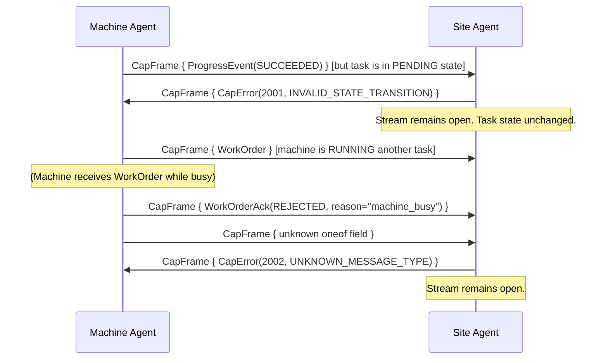

<!--
SPDX-License-Identifier: Apache-2.0
Copyright 2026 CAP Authors
-->

# Chapter 8: Error Handling

> **Normative.** This chapter defines the error model, standard error codes, and required
> behaviors for error conditions in CAP. All conformant implementations MUST follow these
> rules.

---

## 8.1 Error Model Overview

CAP uses a structured error message (`CapError`) transmitted as a `CapFrame` body within
the existing bidirectional stream. Errors are classified into three domains:

| Domain | Code Range | Description |
|--------|-----------|-------------|
| `TRANSPORT` | 1000–1999 | Connection, heartbeat, serialization, and TLS errors |
| `PROTOCOL` | 2000–2999 | State machine violations, unknown messages, version mismatches |
| `APPLICATION` | 3000–3999 | Business logic errors: reservation conflicts, task failures, safety |

### 8.1.1 Design Principles

1. **Errors do not close the stream.** Upon receiving a `CapError`, the receiver MUST NOT
   close the bidirectional stream unless `severity = CRITICAL`. This allows recovery from
   transient errors without reconnection overhead.

2. **Errors are traceable.** Every `CapError` includes `related_message_id` pointing to
   the `MessageHeader.message_id` of the frame that triggered the error. This enables
   correlation in audit logs.

3. **Retry guidance is explicit.** The `retryable` flag and `retry_after_sec` field tell
   the sender whether and when to retry the failed operation.

4. **Error severity aligns with FaultSeverity.** The same `FaultSeverity` enum is reused
   for consistency across `CapError`, `FaultEvent`, and `SafetyEvent`.

---

## 8.2 Standard Error Codes

### 8.2.1 Transport Errors (1xxx)

| Code | Name | Severity | Retryable | Description |
|------|------|----------|-----------|-------------|
| 1001 | `CONNECTION_TIMEOUT` | ERROR | Yes | TCP or TLS handshake did not complete within the configured timeout. |
| 1002 | `HEARTBEAT_TIMEOUT` | WARNING | No | No heartbeat received from the peer within `heartbeat_timeout` (default 15s). The site agent SHOULD mark the machine as disconnected. |
| 1003 | `SERIALIZATION_ERROR` | ERROR | No | The received bytes could not be deserialized as a valid protobuf `CapFrame`. |
| 1004 | `STREAM_RESET` | ERROR | Yes | The transport stream was unexpectedly closed by the peer or network. |
| 1005 | `TLS_HANDSHAKE_FAILED` | CRITICAL | No | TLS or mTLS negotiation failed (certificate invalid, expired, or untrusted). |

### 8.2.2 Protocol Errors (2xxx)

| Code | Name | Severity | Retryable | Description |
|------|------|----------|-----------|-------------|
| 2001 | `INVALID_STATE_TRANSITION` | WARNING | No | The received message would cause an invalid state transition (see Chapter 6). The current state is unchanged. |
| 2002 | `UNKNOWN_MESSAGE_TYPE` | WARNING | No | The `CapFrame.body` oneof field is not recognized. This typically occurs when one peer is running a newer protocol version. |
| 2003 | `VERSION_MISMATCH` | ERROR | No | No common protocol version exists between the `ConnectRequest.supported_versions` and the site agent's supported versions. The stream SHOULD be closed. |
| 2004 | `INVALID_MESSAGE` | WARNING | No | The message is syntactically valid protobuf but semantically invalid (missing required fields, out-of-range values, empty `machine_id`, etc.). |
| 2005 | `DUPLICATE_MESSAGE_ID` | INFO | No | A message with the same `MessageHeader.message_id` was already processed. The duplicate is silently discarded after sending this error. |
| 2006 | `UNEXPECTED_MESSAGE` | WARNING | No | The message type is valid but not expected in the current protocol state (e.g., `ProgressEvent` before `WorkOrderAck`). |
| 2007 | `SEQUENCE_VIOLATION` | WARNING | No | Messages arrived out of the expected logical sequence. Within a single gRPC stream, ordering is guaranteed; this code applies to cross-stream or MQTT scenarios. |

### 8.2.3 Application Errors (3xxx)

| Code | Name | Severity | Retryable | Description |
|------|------|----------|-----------|-------------|
| 3001 | `RESERVATION_CONFLICT` | WARNING | Yes | The requested resource is already reserved by another holder. `details` SHOULD include the current holder_id and expected release time. `retry_after_sec` SHOULD be set. |
| 3002 | `TASK_NOT_FOUND` | WARNING | No | The referenced `task_id` does not exist in the site agent's task registry. |
| 3003 | `MACHINE_BUSY` | WARNING | Yes | The machine has an active task in `RUNNING` or `BLOCKED` state and cannot accept a new `WorkOrder`. |
| 3004 | `SKILL_NOT_SUPPORTED` | WARNING | No | The `skill` in the `WorkOrder` is not listed in the machine's `CapabilityManifest.capabilities`. |
| 3005 | `SAFETY_VIOLATION` | CRITICAL | No | The requested action is blocked by the Safety Supervisor (e.g., entering a keepout zone). |
| 3006 | `AUTHORIZATION_DENIED` | ERROR | No | The sender does not have the required role/permission for the requested action (see Chapter 9: Security). |
| 3007 | `RESOURCE_NOT_FOUND` | WARNING | No | The referenced resource (zone_id, machine_id, reservation_id) does not exist. |
| 3008 | `PLAN_HASH_MISMATCH` | WARNING | No | The `plan_hash` in the message header does not match the currently active plan. This may indicate a stale or conflicting plan. |
| 3009 | `CAPACITY_EXCEEDED` | WARNING | No | The requested volume, weight, or other quantity exceeds the machine's declared capability limits. |
| 3010 | `RATE_LIMIT_EXCEEDED` | WARNING | Yes | The sender is exceeding the allowed message rate. `retry_after_sec` SHOULD be set. |
| 3011 | `MESSAGE_TOO_LARGE` | ERROR | No | The serialized CapFrame exceeds the `max_message_size` (default 4 MB). The sender MUST reduce the payload. |
| 3012 | `DIALOGUE_APPROVAL_TIMEOUT` | WARNING | No | No approval decision was received within the dialogue timeout window (recommended 60s). The machine SHOULD continue with the original plan (see Chapter 6, Section 6.5.3). |

---

## 8.3 Behavioral Specifications

### 8.3.1 Concurrent WorkOrder Handling

A Machine Agent MUST have at most one task in `RUNNING` or `BLOCKED` state at any time.

**When a second WorkOrder arrives while a task is active:**

1. If the machine can queue the work: respond with `WorkOrderAck(DEFERRED)` and set
   `retry_after_sec` to an estimated time until the current task completes.
2. If the machine cannot queue: respond with `WorkOrderAck(REJECTED)` with
   `reason = "machine_busy"`.
3. The machine MUST NOT silently drop the WorkOrder.

**Queue semantics:**

- A Machine Agent MAY maintain a deferred queue with a depth of at most **1** WorkOrder.
  If the queue is full, additional WorkOrders MUST be `REJECTED(machine_busy)`.
- Deferred WorkOrders are processed in **FIFO** order after the active task completes.
- `WorkOrderAck(DEFERRED)` does NOT guarantee eventual execution; the Site Agent MAY
  send `CancelWorkOrder` for a deferred task at any time.

**Site Agent behavior:**

- On receiving `DEFERRED`: the Site Agent SHOULD retry after `retry_after_sec` or
  reassign the WorkOrder to a different machine. The Site Agent MAY retry before
  `retry_after_sec` but SHOULD respect the hint.
- On receiving `REJECTED(machine_busy)`: the Site Agent SHOULD reassign immediately.

### 8.3.2 Reconnection Protocol

When a transport connection is lost (detected via heartbeat timeout or stream error):

**Machine Agent behavior:**

1. Detect disconnection (stream error, send failure, or heartbeat ACK timeout).
2. Enter `SAFE_STOP` if currently in `SUPERVISED_AUTONOMY` or `AUTONOMY` mode.
3. Attempt reconnection with exponential backoff:
   - Initial delay: 1 second
   - Maximum delay: 60 seconds
   - Backoff factor: 2×
   - Jitter: ±25% of the computed delay
4. On successful reconnection:
   a. Send a fresh `CapabilityManifest` (first message in the new stream).
   b. If a task was active at disconnection, include `active_task_id` in `Heartbeat`.
   c. Resume heartbeat loop.

**Site Agent behavior:**

1. Detect machine disconnection via heartbeat timeout (default 15 seconds).
2. Mark the machine as `DISCONNECTED` in the machine registry.
3. For any task in `RUNNING` state assigned to the disconnected machine:
   a. Start a **grace period** (implementation-defined, recommended 30 seconds).
   b. If the machine reconnects within the grace period and reports the same
      `active_task_id`, resume the task (no state change).
   c. If the grace period expires, transition the task to `FAILED` with
      `reason = "machine_disconnected"`.
4. On machine reconnection:
   a. Process the new `CapabilityManifest`.
   b. Compare `active_task_id` in the first Heartbeat against the task registry.
   c. If the task is still in `RUNNING` and within the grace period: resume.
   d. Otherwise: send `CancelWorkOrder` for the stale task.

### 8.3.3 Partial Failure Recovery (TaskGraph)

When a `TaskGraph` consists of multiple dependent tasks and one task fails:

1. **Immediate tasks**: The Site Agent MUST send `CancelWorkOrder` to all tasks in
   `PENDING` or `ACCEPTED` state that depend (directly or transitively) on the failed task.

2. **Running tasks**: Tasks in `RUNNING` state that do NOT depend on the failed task
   MAY continue to completion.

3. **Work package status**: The Site Agent marks the work package as `PARTIAL_FAILURE`
   and records in the audit trail:
   - Which task failed and why
   - Which tasks were cancelled
   - Which tasks completed successfully
   - The `plan_hash` of the original plan

4. **Re-planning**: The Site Agent MAY generate a new `GoalSpec` for the remaining work,
   producing a new `TaskGraph` with a new `plan_hash`. This is a new planning cycle,
   not a modification of the failed plan.

### 8.3.4 Network Partition Behavior

When the network between Site Agent and Machine Agent is partitioned:

**Detection:**
- Machine Agent: heartbeat send fails or no response within `heartbeat_timeout`.
- Site Agent: no heartbeat received within `heartbeat_timeout`.

**Machine Agent behavior during partition:**
1. If in `AUTONOMY` or `SUPERVISED_AUTONOMY`: enter `SAFE_STOP` after `heartbeat_timeout`.
2. If in `TELEOP`: enter `SAFE_STOP` after `heartbeat_timeout` (operator link is also lost).
3. If in `MANUAL`: no automatic action (operator is physically present).
4. Continue attempting reconnection per Section 8.3.2.

**Site Agent behavior during partition:**
1. Mark machine as `DISCONNECTED`.
2. Do NOT reassign the machine's reservation immediately — wait for the grace period.
3. After grace period: release reservations held by the disconnected machine.

**Post-partition recovery:**
1. Machine reconnects per Section 8.3.2.
2. Site Agent verifies world state consistency (machine position, task progress).
3. If consistent: resume operations.
4. If inconsistent: Site Agent sends `CancelWorkOrder` and issues a new plan.

### 8.3.5 Plan Hash Mismatch Recovery

When a Machine Agent or Site Agent detects `PLAN_HASH_MISMATCH` (error 3008):

1. The `plan_hash` in a received message does not match the currently active plan on
   the receiver side. This typically occurs when the Site Agent recompiles the
   `TaskGraph` (e.g., due to zone changes or re-planning) while tasks are in flight.

2. **Machine Agent behavior on receiving 3008:** The machine MUST NOT continue
   execution under the stale plan. It SHOULD transition the task to `BLOCKED` with
   `summary = "plan_hash_mismatch"` and await further instructions.

3. **Site Agent behavior on receiving 3008:** The Site Agent MUST cancel the stale
   task via `CancelWorkOrder` and, if the work is still required, re-compile the
   `TaskGraph` and dispatch new `WorkOrders` with the updated `plan_hash`.

4. **Audit trail:** Both parties MUST log the mismatch event with the old and new
   `plan_hash` values.

### 8.3.6 Message Ordering Guarantees

| Transport | In-stream Ordering | Cross-stream Ordering |
|-----------|-------------------|----------------------|
| gRPC (bidirectional stream) | **Guaranteed** by HTTP/2 framing | N/A (single stream) |
| MQTT | **Not guaranteed** (QoS 0) / **At least once** (QoS 1) | Not guaranteed across topics |
| WebSocket | **Guaranteed** within a single connection | N/A (single connection) |

**Handling out-of-order messages:**

1. Use `MessageHeader.sent_at` to detect out-of-order arrival.
2. If a `ProgressEvent` arrives with `sent_at` earlier than the last processed
   `ProgressEvent` for the same `task_id`, the receiver SHOULD:
   - Accept it if the state transition is still valid.
   - Discard it with `CapError(2007, SEQUENCE_VIOLATION)` if it would cause
     a backward state transition.
3. `MessageHeader.correlation_id` MUST be used to associate responses with requests
   (e.g., `WorkOrderAck.correlation_id` matches `WorkOrder.message_id`).

### 8.3.7 Invalid Message Handling

When a `CapFrame` is received that cannot be processed:

1. **Unrecognized `oneof` body field**: Respond with `CapError(2002, UNKNOWN_MESSAGE_TYPE)`.
   Do NOT close the stream.

2. **Missing required fields** (e.g., `WorkOrder` without `task_id`): Respond with
   `CapError(2004, INVALID_MESSAGE)` including the field name in `details`.
   Do NOT close the stream.

3. **Malformed protobuf** (deserialization failure): Respond with
   `CapError(1003, SERIALIZATION_ERROR)`. The stream MAY be closed if repeated
   serialization errors indicate a corrupted peer.

4. **Unknown enum values**: Per protobuf semantics, unknown enum values are preserved
   as their integer representation. The receiver SHOULD treat unexpected enum values
   as `UNSPECIFIED` and respond with `CapError(2004)` if the UNSPECIFIED value is
   not acceptable in the current context.

---

## 8.4 Error Response Flow

---

## 8.5 Severity Escalation

| Severity | Receiver Action | Stream Action |
|----------|----------------|---------------|
| `INFO` | Log only. No action required. | Keep open |
| `WARNING` | Log and optionally notify operator. | Keep open |
| `ERROR` | Log, notify operator, consider corrective action. | Keep open |
| `CRITICAL` | Log, alert immediately. Machine SHOULD enter `SAFE_STOP`. | Close stream after sending/receiving |

When a `CRITICAL` error is received:
1. Log the error with full details.
2. If the receiver is a Machine Agent: enter `SAFE_STOP` mode.
3. If the receiver is a Site Agent: mark the machine as requiring manual intervention.
4. The stream MAY be closed after sending the CRITICAL error.
