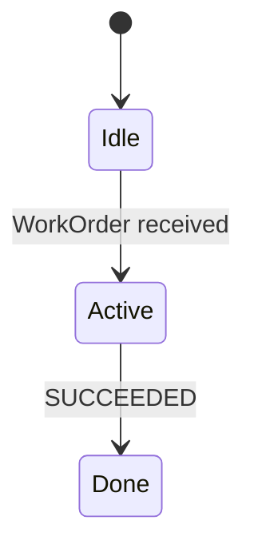

<!--
SPDX-License-Identifier: Apache-2.0
Copyright 2026 CAP Authors
-->

# RFC-NNNN: <Short Title>

| Field | Value |
|---|---|
| RFC | NNNN |
| Title | <Short Title> |
| Author(s) | <Your Name> (`@github-handle`) |
| Status | Draft \| Proposed \| Accepted \| Final \| Rejected \| Withdrawn \| Superseded |
| Created | YYYY-MM-DD |
| Last Updated | YYYY-MM-DD |
| Related ADR | (optional, link to docs/adr/NNN-*.md if applicable) |
| Related Discussion | (link to GitHub Discussion thread) |
| Reference Implementation | (link to PR in cap-reference / other repo) |
| Supersedes | (optional, list RFC numbers this replaces) |
| Superseded by | (optional, link to successor RFC if Status=Superseded) |

## Summary

One-paragraph summary (3-5 sentences). Aim for "I should be able to predict the rest
of the RFC after reading just this paragraph."

## Motivation

Why is this change necessary? What problem does it solve? Be concrete:
- 既存仕様の何が unable / awkward / inconsistent なのか
- 誰がどんなユースケースで困っているのか
- この RFC が approve されないと何が起こり続けるのか

## Background

(optional) この RFC を読むのに必要な既存知識を簡潔に。深い説明は別 doc を参照させる。

## Detailed Design

具体的な変更内容。**ここが RFC の本体**。以下を含む:

### Proto schema changes

```protobuf
// Before
message Foo {
  string bar = 1;
}

// After
message Foo {
  string bar = 1;
  string baz = 2;  // NEW
}
```

### State machine changes

(該当する場合) state 遷移図 / matrix を mermaid で書く:



### Wire compatibility

- 既存実装 (cap-reference v0.x) は新しい proto を解釈できるか?
- 古い実装 → 新しい実装の forward compat
- 新しい実装 → 古い実装の backward compat
- breaking change の場合: migration path を必須記述

### Conformance impact

- 既存 conformance Level (1/2/3) のテストは影響を受けるか?
- 新しいテストが必要か?

### Security impact

- 新しい attack surface はあるか?
- mTLS / RBAC との相互作用

### Performance impact

- wire size の増減
- CPU / memory 影響

## Alternatives Considered

検討した他の選択肢と、それぞれを採用しなかった理由。「何もしない (status quo を維持)」
も必ず alternative として書く。

## Open Questions

RFC を merge する前に解決しなければならない論点。コミュニティへの問いかけ。

## Migration Plan

(breaking change の場合) 既存実装が新仕様に migrate するための手順。Deprecation 期間
(通常 2-minor versions)、wire-compatibility window 等を明記。

## Rollout Plan

- Reference implementation がいつ landed する見込みか
- Conformance suite の更新タイミング
- Documentation 更新

## References

- 関連する既存 ADR / RFC
- 外部 standards (ISO / VDA 等)
- 学術論文
- 他の OSS プロトコルでの類似事例
