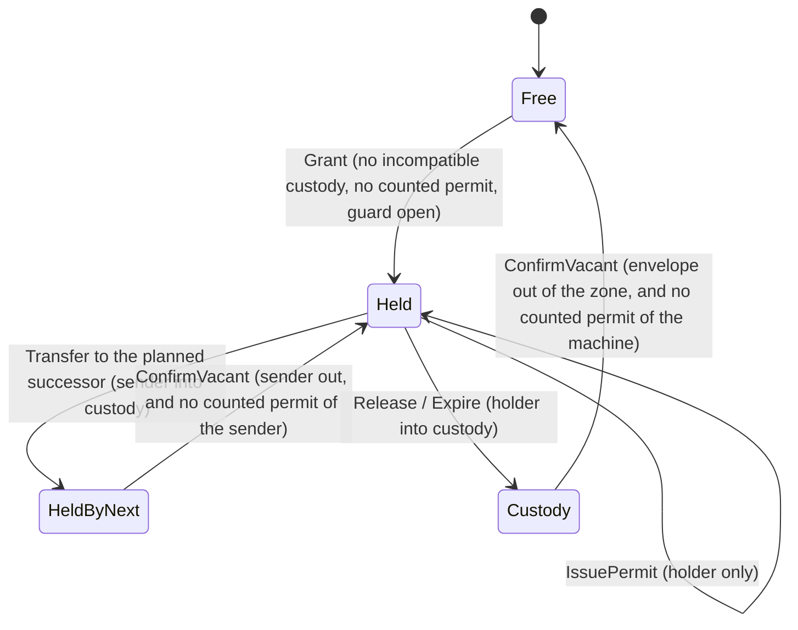

<!--
SPDX-License-Identifier: Apache-2.0
Copyright 2026 CAP Authors
-->

# RFC-0003: Occupancy-gated reservation — entry permits, custody and vacancy

| Field | Value |
|---|---|
| RFC | 0003 |
| Title | Occupancy-gated reservation: entry permits, custody and vacancy |
| Author(s) | R-Okauchi (`@R-Okauchi`) |
| Status | Proposed |
| Created | 2026-11-11 |
| Last Updated | 2026-11-11 |
| Related ADR | ADR-008 (versioning: v0 is additive-only) |
| Related Discussion | (TBD) |
| Reference Implementation | `cap-coordination-kit` v0.2.0 (`occupancy.py`, `entry_gate.py`, `occupancy_conformance.py`, `scheme_trial.py`); formal model `formal/tla/OccupancyHandover.tla`, `formal/tla/PermitTiming.tla`, results in `formal/tla/family/` |

## Summary

Reservation の所有 (誰が資源を持っているか) と、物理的な占有 (誰がその場所に居るか) は別のものである。v0 の Reservation と
Handover は所有だけを定めていて、「解放した機体がまだ中に居る」「失効した持ち主がまだ中に居る」場合に、次の機体が入ることを
妨げない。本 RFC は、資源に **競合領域 (conflict zone)** が結び付いているときの Reservation の意味を定める:
(1) 領域に入る直前に機体が受け取る **進入許可 (entry permit)**、(2) 解放・失効・受け渡しの後、退避が確かめられるまで元の
持ち主を **預かり (custody)** に置くこと、(3) 許可の期限の測り方、(4) 裁定役の再起動の規則、(5) 付与が他者の行為で終わった
ことの知らせ、(6) 機体の側に求める **進入の門 (entry gate)**。ワイヤの変更は追加のみ (ADR-008) で、今の参照実装は既存の欄の
上の符号化で動いている (下の「Wire encoding」)。

## Motivation

- フェンシング (`grant_epoch`) は、古い利用者の要求から裁定役の状態を守る。古い利用者の **機体がどこに立っているか** は守らない。
  mutex を終了時に解放する方式と、退避を確かめないリースは、どちらも 2 台目を中に入れてしまう
  (`formal/tla/family/`: 90 通りの方式のうち、Site の協調役が持ち主に代わって区画を譲りうるとき S1–S3 を満たす 8 通りは、
  全部が「裁定あり・期限つきの進入許可の門・退避の確認後に解放」。任意の台数の証明は `formal/smt/occupancy_inductive.py`)。
- 参照実装の評価で、退避の確認が機体の側にあって時間切れで開くこと、失効が時間窓だけで決まること、進入の瞬間に予約を確かめる
  ものが機体に無いことが、実際に重なりを生んだ。
- 利用者 (Site の計画役、機体のオペレータ) は言語モデルでありうる。どんな要求が来ても安全の性質が保たれるには、要求を受ける
  決定的な部分 (裁定役と進入の門) の規則が仕様として定まっている必要がある。

## Background

用語は `formal/tla/OccupancyHandover.tla` と同じ。

- **競合領域**: ある機体の組が同時に居てはならない領域。資源 ID に結び付く。**両立の関係** を持つ
  (積込の区画では、運搬車どうしは両立しない。積込機は区画の持ち主の運搬車と両立する)。
- **安全の性質**: S1 両立しない 2 台が同じ領域に同時に居ない / S2 領域に居る機体は、持ち主か預かりとして裁定役が把握している /
  S3 後の付与で置き換えられた権限では入らない。
- **追加の保証**: G1 承継が計画されている間、領域の持ち主が空にならない / G2 計画された機体以外には渡らない /
  G3 待つ機体はいつか入れる / G4 止まった持ち主は、いつか復帰するか領域を失う。

## Detailed Design

以下は、競合領域が結び付いた資源についての規範。領域の無い資源の Reservation は今のまま。

### 1. 進入許可 (entry permit)

- 機体は、競合領域の境を越える前に、裁定役から進入許可を受ける。許可は **1 回の進入にだけ** 使える。
- 裁定役が許可を出すのは次のときだけ: 要求した機体がその資源の持ち主である / 再起動の見張り (下の 4) が開いている /
  両立しない機体が預かりに居ない。(「両立しない機体の数えている許可が無い」も確かめてよいが、下の 2 の預かりの規則から
  導かれる: 任意の台数の証明で、外しても不変条件は帰納的のまま。)
- 期限 (有効期間 `T`、時計の進み方の相対誤差の上限 `ρ`、どちらも配備の値):
  - 機体は、要求を **送った** 時刻から自分の単調な時計で `T(1−ρ)` の間だけ許可を使えるものとして扱う (受け取った時刻からでは
    ない)。進入を始めてよいのは、残りが `δ_entry(1+ρ)` 以上のときだけ (`δ_entry` は門の判断から境を越えるまでの上限)。
  - 裁定役は、付与から自分の単調な時計で `T(1+ρ)` の間、その許可を「使われうる」と数える。
  - この 2 つで、機体が許可を使いうる実時間の区間は、裁定役が数える区間に含まれる
    (`formal/tla/PermitTiming.tla`: 送った時刻から測る版は成立、受け取った時刻から測る版と `ρ` を無視する版は反例)。
  - 期限を壁時計で測ってはならない。機体が再起動したら、持っていた許可は無いものとする。

### 2. 預かり (custody) と退避の確認

- 持ち主が解放したとき、失効したとき、受け渡しで持ち主が変わったとき、元の持ち主は **預かり** に入る。
- 預かりから外れるのは、次の 2 つがそろったときだけ (預かりの規則): (a) 裁定役がその機体の退避を確かめた、(b) その機体に
  その領域について出した許可で、裁定役がまだ数えているものが 1 つも無い。(b) が無いと、Site の協調役が代わりに解放した
  (または受け渡した・失効させた) とき、知らせを受け取れない機体 (通信が切れている) が使っていない許可で、外に居ると
  確かめられた後に入れてしまい、誰にも把握されない (任意の台数の証明の試みで見つかった。模型では 7 歩の反例)。
- 退避の確認は確定的な包絡で行う: 報告された位置を
  `ε + v_max·(位置の古さ + 通信の遅れ) + d_brake` だけ膨らませた範囲が領域の外にあること。位置が無い、または古さが上限を超える
  ときは、退避していないものとする。`ε` は測位の仕様の上限から決める (観測した誤差から決めない)。
- 退避は、それぞれが前より新しい位置の報告に基づく `k` 回の連続した観測がどれも外を示したときに確かめてよい (`k` は配備の値、
  既定 1)。誤差に上限の無い測位では、誤確認の確率を下げる。ただし誤差が時間的に相関すると効きは小さい (相関 0.9 では
  3 回でも必要な余裕は 1 割しか減らない)。確認の記録には、観測の回数と位置の古さを残す。
- 両立しない機体が預かりに居る間、裁定役は新しい付与も進入許可も出さない。
- 論理的な解放そのものは受け付けてよい (利用者が早すぎる解放を要求しても、預かりが次の機体を止める)。

### 3. 失効

- 持ち主が沈黙したとき、裁定役がその付与を失効させてよいのは、その機体の数えている許可が 1 つも無いときだけ。
- 失効した機体は預かりに入る (上の 2)。失効で預かりに入れない方式 (退避を確かめないリース) は S1・S2 を満たさない。
- 時計の前提 (上の 1 の `ρ`) は、預かりの規則の (b) を通じて、Site が区画を譲りうる全部の方式の安全に要る (失効を使わない
  方式でも)。`ρ` を保証できない配備では、Site は持ち主に代わって区画を譲ってはならない: 持ち主の確認を待つか、人が外す。

### 4. 裁定役の再起動

- 付与・受け渡し・進入許可は、効果が出る前に日誌に書いて同期する。書けなければ断る。
- `grant_epoch` は (起動の識別子, 世代) の組とする。起動の識別子は起動ごとに新しい乱数で、同じ起動の中で世代は単調に増える。
- 日誌があれば、持ち主・預かり・世代・数えている許可を戻す (許可は戻した時刻から `T(1+ρ)` 数え直す)。
- 日誌を失ったら、全部の領域を閉じる: `T(1+ρ)` が経つまで待ち、その後、把握している全機体の退避を確かめてから開く。
  この待ちは起動の識別子の有無によらず要る (再接続していない機体は再起動を知らず、手元の許可を有効とみなす)。

### 5. 指名した承継と、付与の終わりの知らせ

- 計画が次の機体を指名しているとき、解放と失効は、その機体への受け渡しとして 1 歩で行う (領域の持ち主が空にならない。
  元の持ち主は預かりに入る)。指名された機体以外の要求は断る。
- 付与が持ち主以外の行為で終わったとき (Site の協調役が代わりに解放した、受け渡した、失効させた)、裁定役は元の持ち主に
  それを知らせる (終わった付与の `grant_epoch` を添える)。機体は、その世代の付与の記憶と許可を捨てる。
  知らせが届かない場合に備えて、機体の門は期限つきの許可に依るべきである (付与の記憶だけに依る門は、知らせを失うと古い
  記憶で動く)。

### 6. 機体の進入の門 (entry gate)

機体の実装への要求。門は走行の指令が駆動へ書かれる経路の上に置き、利用者 (言語モデルを含む) から迂回できないこと。

- 指令ごとに確かめる (最初の 1 回だけではない)。確かめの間隔の上限 `τ_check` を持つ。
- 判定は「この指令を今書き、次の確かめで停止を書いたとき、止まるまでに通りうる所」で行う (指令の遅れ・加減速の上限・`τ_check`
  を含む)。権限の無い領域にその経路が入る指令は、遅くして書くか、書かない。直線の先読みでは足りない。
- 通した指令は 1 周期だけ有効。次の確かめが `τ_check` 以内に来なければ、門が自分で停止を書く。
- 権限なしに領域の中に居る機体と、領域の中で Site との接続が運転のリースより長く切れている機体は、外へ向かう動きだけを許す。
- 進入のたびに、使った権限 (世代) を記録する。

### 7. 領域の表 (zone table) — 門が領域を知るまで許可を出さない

門が機体を領域の外に留められるのは、その領域を知っているときだけである。模型 (`OccupancyHandover`) は門が領域を知っている
ことを前提にしているので、実装は次の規則でその前提を満たす (`formal/tla/ZoneTable.tla`)。

- 裁定役は領域の表を持ち、領域を足す・変えるたびに版を上げる。表は (起動の識別子, 版) で名指す。
- 裁定役は、声を聞いた全部の機体に表を送る。機体は、門が従っている表 (起動の識別子と版) をハートビートごとに知らせる
  (状態の報告なので、1 つ失われても次で補われる)。表を持たない門は、そのことを知らせる。
- 表を受け取っていない門、判定に使う位置を持たない門は、どの走行の指令も通さない (知らない領域には留められないので、
  開く側には倒さない)。
- 裁定役は、ある領域の付与も進入許可も、その領域に入れない他の全部の既知の機体が「今の形の領域を含む、今の起動の表」を
  知らせてくるまで出さない。
- 門は、同じ起動の古い版の表と、すでに置き換えた起動の表を捨てる。
- 再起動: 日誌があれば、領域も日誌から戻す (新しい起動の最初の表に領域が入っている)。日誌を失ったら、裁定役は
  `T(1+ρ)` の待ちが終わるまで表を送らない。新しい起動の表はまだ空かもしれず、それを受け取った門は、前の起動の許可が
  まだ使える間に領域を手放してしまうからである (この反例は模型が見つけた)。
- 領域を動かさない規則: 裁定役は、持ち主が居る・退避の確認待ちの機体が居る・使われうる進入許可が出ている領域を、動かさない
  (登録し直しの要求は断り、登録済みの領域がそのまま立つ)。登録済みの領域から 0.1 m 以内 (中心と半径) の登録し直しは、
  同じ領域として扱い、表の版を上げない。積込機の位置の報告は止まっていても cm の単位で揺れるので、これが無いと
  報告のたびに全部の門が新しい表を確認し直すことになる (参照実装の物理の試行で起きた)。
- 前提: ストリームは順序を保つ (機体の再起動は新しいストリームで始まる)。
- 残る前提: 領域を登録する時点で、その領域に入れない機体が中に居ないこと (居た場合の扱いは本 RFC の外)。

### 8. 身元

- 各ストリームは、開いた機体の身元に結び付ける。他の機体の名での要求・解放・受け渡しは断る。
- 安全 (S1–S3) は身元に依らない: 他の機体の名での解放や受け渡しは、Site の協調役の解放と同じく、元の持ち主を預かりに入れ、
  上の 2 の規則が入れなくなるまで把握し続ける。身元は可用性のため (他の機体に区画を奪われない) に要る。安全が依るのは、
  許可がそれを出された機体にだけ届き、偽れないこと。

### Wire encoding (v0、追加なし)

今の参照実装は、既存の欄だけで次のように符号化している。

| 意味 | 符号化 |
|---|---|
| 進入許可の要求 | `ReservationRequest` で `reason = "entry_permit"`、`holder_id` = 要求した機体 |
| 進入許可 | `ReservationStatus` で `state = GRANTED`、`reason = "entry_permit"`、`grant_epoch` = 許可の世代 |
| 進入許可の拒否 | `ReservationStatus` で `state = DENIED`、`reason` に理由 |
| 世代 | `grant_epoch` (uint64) の上位 32 bit = 起動の識別子、下位 32 bit = 世代 |
| 領域の表 | 要求への答えでない `ReservationStatus` (`reservation_id`・`resource_id` 空)、`reason = "cap.zone-table:" + JSON {boot, version, zones: [{resource_id, x, y, radius_m, compatible}]}` |
| 門が従っている表の報告 | `Heartbeat.health` の `cap.zone_table` = `"<boot>:<version>"` (表を持たなければ欄なし) |
| 付与の終わりの知らせ | 要求への答えでない `ReservationStatus` (`reservation_id` 空)、`state = RELEASED` または `EXPIRED`、`holder_id` = 元の持ち主、`grant_epoch` = 終わった付与の世代 |

### Proto schema changes (提案、未適用)

上の符号化は `reason` の文字列に意味を載せている。v0.x で次を **追加のみ** で足すことを提案する (受け手が知らなければ今の符号化に
落ちる):

```protobuf
message ReservationRequest {
  // ...
  enum Kind { KIND_UNSPECIFIED = 0; KIND_RESERVATION = 1; KIND_ENTRY_PERMIT = 2; }
  Kind kind = N;                       // NEW
}

message ReservationStatus {
  // ...
  google.protobuf.Duration permit_valid_for = N;   // NEW: T, when this status is an entry permit
  repeated string custody = N+1;                    // NEW: machines not yet confirmed out (informational)
  bool grant_ended = N+2;                           // NEW: this status reports the end of a grant by another's act
}
```

### State machine changes

持ち主の状態機械に「預かり」が加わる。



### Wire compatibility

- 競合領域を登録しない配備は影響を受けない。
- 進入許可を知らない機体は許可を求めない。裁定役は付与だけで動く (その機体は「付与の記憶に依る門」または門なしの方式になり、
  下の表の保証しか持たない)。
- `grant_epoch` の上位 32 bit を見ない受け手には、世代が大きな数に見えるだけで、大小の比較は同じ起動の中で保たれる。

## Formal verification

`formal/tla/OccupancyHandover.tla` (方式の族)、`formal/tla/family/` (結果)。2 台・3 世代・再起動 1 回の範囲 (安全な方式は 3 台でも
再検査)。

| 方式 | S1–S3 (Site の解放あり、日誌あり) | 同 (日誌なし) | S1–S3 (持ち主の解放だけ、日誌あり) | G1・G2 | G4 |
|---|---|---|---|---|---|
| mutex、終了時に解放 | × | × | × | – | – |
| mutex group、退出で解放 | × | × | ✓ | × | – |
| 更新とフェンシング付きのリース | × | × | × | – | – |
| リース + 退避の確認 | ✓ | ✓ | ✓ | × | ✓ |
| 本 RFC の全部 (待ち行列・期限つき許可・退避後に解放・預かりへの失効・指名) | ✓ | ✓ | ✓ | ✓ | ✓ |

前提を外した結果 (Site の解放あり、安全な 8 通りについて): 退避の確認が健全でない (A2 なし)、時計の前提が無い (A4 なし、日誌が
あっても)、預かりの規則の (b) が無い、日誌を失った後の待ちが無い (起動の識別子があっても) — どれでも 8 通りとも安全でない。
身元が無い (A5 なし) ときは 8 通りとも安全のまま (指名の 4 通りは G1・G2 も)。
任意の台数・領域・許可について、上の規則 (門と 1 回限りの許可、持ち主への許可、預かりの規則、許可の期限の補題、健全な退避の
確認、再起動の待ち) で S1–S3 が成り立つ: `formal/smt/occupancy_inductive.py` (不変条件 10 本、15 行為、150 課題を Z3 で確認)。

領域の表 (`formal/tla/ZoneTable.tla`、2 台・再起動 1 回・表の版 2・領域の形 2 通り): 上の規則で「許可を持つ機体が居る間、
他の機体の門は確かめなしにその領域へ通さない」が成り立つ (50,712,315 状態)。確認を待たずに許可を出す・表の無い門が通す・
日誌を失った再起動の直後に表を送る、のどれでも反例が出る。

## Conformance

`cap-conformance` に足す試験 (提案): 預かり中の進入許可の拒否 / 許可の数えている間の付与の拒否 / 許可が数えられている
機体を預かりから外さない / 失効は許可が切れてから /
受け渡しで送り手が預かりに入る / 日誌を失った再起動の後の待ち / 他の機体の名での要求の拒否 / 付与の終わりの知らせ。
記録からの検査は `cap-coordination-kit` の `occupancy_conformance.py` (裁定役の記録・門の記録・真の位置を模型の規則で追い直す)。

## Alternatives considered

- **退避の確認を機体の側に置く** (元の実装): 相手の位置を自己申告で読み、時間切れで開く。失敗したときに開く側に倒れる。
- **フェンシングだけ**: 裁定役の状態は守るが、機体の位置は守らない (上の表の 3 行目)。
- **起動の識別子だけで日誌なしの再起動を安全にする**: 再接続していない機体が古い許可を持ち続けるので足りない (上の 4)。

## Unresolved questions

- `ε` を確定的に置けない測位では、保証は確率的になる (重なりの確率 ≤ 誤差が `ε` を超える確率)。誤差の広がりと時間相関から
  余裕と `k` を決める表の規範化。退避の確認を、出ていく機体の自己申告に依らないセンサで行う構成の規範。
- 領域が円でない場合 (掃く体積、運搬路、交差点) の包絡。
- 裁定役の複製。
